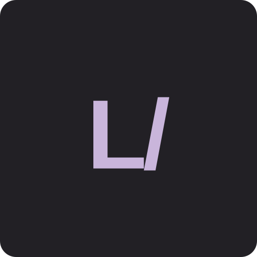

# Limagination

> **We Begin with Imagination.**
> 호기심이 우리의 시작이다. 상상이 우리의 언어다.

LIMAGINATION의 회사 브랜드 자산과 개발 오케스트레이터를 관리하는 저장소입니다. 회사의 철학과 개별 제품의 정체성을 분리해 관리합니다.

## 구조

\`\`\`
├── brand/                         # 회사 고유 자산
│   ├── LIMAGINATION_BRAND_CONSTITUTION.txt
│   ├── LIMAGINATION_BRANDING_REPORT.txt
│   ├── LIMAGINATION_SANS_V2_PROMPT.txt
│   ├── LimaginationSans_사용가이드.txt
│   ├── research/                  # 외부 사례 조사 기록 (신조·규칙 아님)
│   └── logo / specimen
│
├── products/
│   └── recall-infinity/            # Recall Infinity 앱 전용 문서
│       ├── PRODUCT_BRAND_GUIDE.md
│       └── HANGUL_FONT_HANDOFF.md
│
├── orch/                           # 자율 코딩 오케스트레이터
└── ...
\`\`\`

## 회사 브랜드와 제품의 경계

- **brand/** 는 LIMAGINATION 자체의 미션, 비전, 가치, 행동 원칙과 공통 브랜드 자산만 다룹니다.
- **products/** 는 개별 제품의 사용자, 기능, UI, 말투, 색상, 마스코트, 구현·운영 문서를 다룹니다.
- 제품은 LIMAGINATION의 철학을 바탕으로 만들 수 있지만, 한 제품의 디자인이나 사용 경험을 회사 전체의 신조로 승격하지 않습니다.
- 제품별 기술 문서와 앱 코드는 각 제품 저장소에서 관리합니다.

## 확정된 회사 워드마크와 심볼 (2026-11-25 · Muted Amethyst)

- **공식 브랜드명:** `LIMAGINATION` (기존 브랜드 헌장 표기 유지)
- **워드마크:** `LIMA.` · Porcelain `#F4F1F5` / Amethyst Noir `#222025`
- **심볼:** `L/` · Amethyst Noir `#222025` / Soft Amethyst `#C9B5DB`
- **보조 심볼:** 라이트 `#F4F1F5/#62516F`, 딥 `#62516F/#F4F1F5`
- **브랜드 철학:** We Begin with Imagination. (기존 유지)

| 워드마크 | 심볼 |
| --- | --- |
|  |  |

[회사 비주얼 아이덴티티 가이드](brand/LIMAGINATION_VISUAL_IDENTITY.md)에서 사용 규칙·원본 SVG·명칭 구분을 확인할 수 있습니다. `LIMA.`는 축약형이며 공식 회사명은 계속 `LIMAGINATION`입니다. 제품별 디자인 시스템은 독립적으로 유지합니다.

## Threads 공식 프로필 (2026-11-23)

- **표시 이름:** LIMAGINATION
- **공식 프로필 로고:** [L/ 심볼](brand/visual/LIMAGINATION_SYMBOL_L_SLASH.svg) — 원형 아이콘용
- **LIMA. 워드마크:** [원본 SVG](brand/visual/LIMAGINATION_WORDMARK_LIMA.svg) — 브랜드 소개용
- **소개글·첫 고정 게시글·운영 규칙:** [Threads 프로필 가이드](brand/LIMAGINATION_THREADS_PROFILE.md)
- 스레드 계정의 실제 프로필 수정과 고정 게시 작업은 계정 소유자가 진행합니다.

## 별도 제품 저장소

- **RecallInfinity** — Recall Infinity 앱 본체: https://github.com/haejoonlim/RecallInfinity
- **soul-commander** — 게임 본체: https://github.com/haejoonlim/soul-commander
- **limagination-workspace** — soul-commander 에셋 작업장

