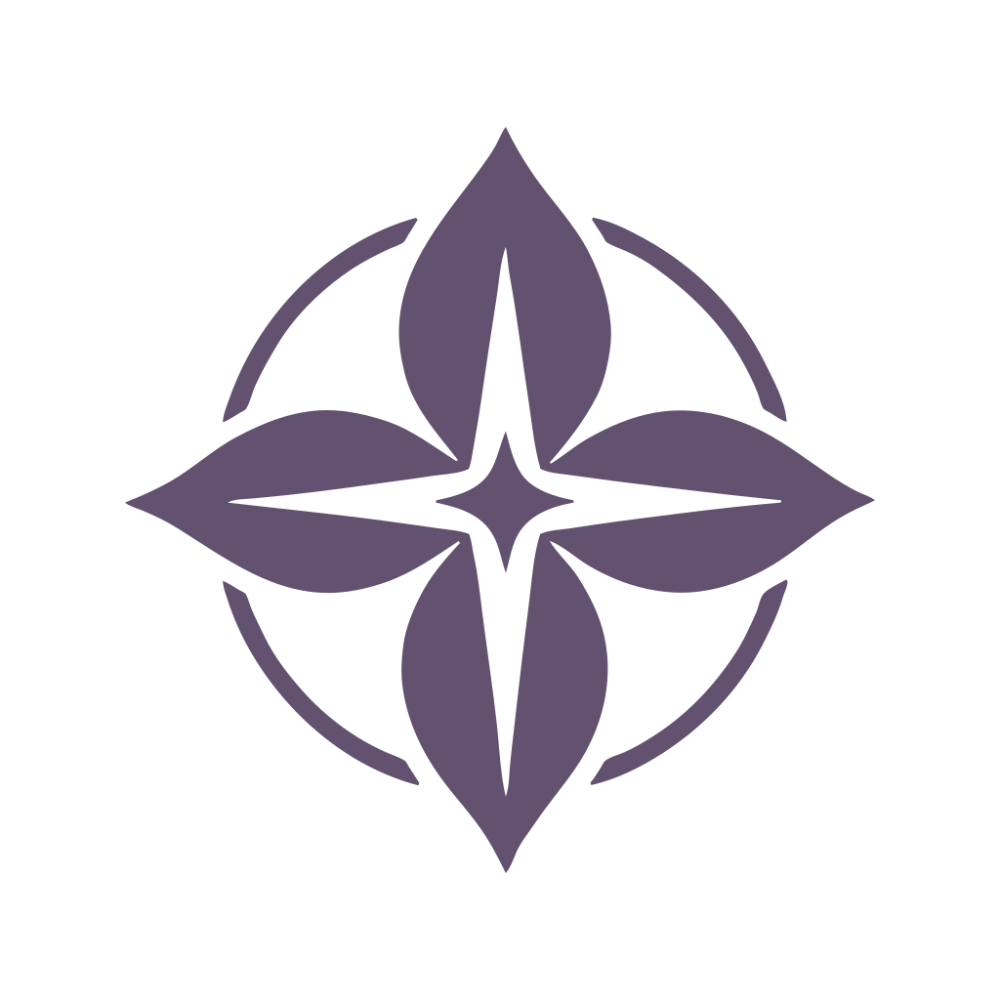

# Limagination

> **Dare to Imagine.** — 상상할 용기를 가져라.
>
> We Begin with Imagination.
> 호기심이 우리의 시작이다. 상상이 우리의 언어다.

LIMAGINATION의 회사 브랜드 자산과 개발 오케스트레이터를 관리하는 저장소입니다. 회사의 철학과 개별 제품의 정체성을 분리해 관리합니다.

## 구조

\`\`\`
├── brand/                         # 회사 고유 자산
│   ├── LIMAGINATION_BRAND_CONSTITUTION.txt
│   ├── LIMAGINATION_BRANDING_REPORT.txt
│   ├── LIMAGINATION_SANS_V2_PROMPT.txt
│   ├── LimaginationSans_사용가이드.txt
│   ├── research/                  # 외부 사례 조사 기록 (신조·규칙 아님)
│   └── logo / specimen
│
├── products/
│   └── recall-infinity/            # 이전 Recall Infinity 제품 기록
│       ├── PRODUCT_BRAND_GUIDE.md
│       └── HANGUL_FONT_HANDOFF.md
│
├── orch/                           # 자율 코딩 오케스트레이터
└── ...
\`\`\`

## 회사 브랜드와 제품의 경계

- **brand/** 는 LIMAGINATION 자체의 미션, 비전, 가치, 행동 원칙과 공통 브랜드 자산만 다룹니다.
- **products/** 는 개별 제품의 사용자, 기능, UI, 말투, 색상, 마스코트, 구현·운영 문서를 다룹니다.
- 제품은 LIMAGINATION의 철학을 바탕으로 만들 수 있지만, 한 제품의 디자인이나 사용 경험을 회사 전체의 신조로 승격하지 않습니다.
- 제품별 기술 문서와 앱 코드는 각 제품 저장소에서 관리합니다.

## 공식 회사 시각 자산 — Quiet Compass (2026-11-27 채택)

- **공식 브랜드명:** `LIMAGINATION` (기존 브랜드 헌장 표기 유지)
- **워드마크:** `LIMAGINATION` · 승인 시안의 글자 윤곽 및 넓은 자간을 벡터화
- **심볼:** Quiet Compass (클레마티스 × 나침반) · Amethyst Noir `#222025` / Soft Amethyst `#C9B5DB`
- **공식 모토:** Dare to Imagine. (2026-11-27)
- **철학적 근원:** Sapere Aude. — 스스로 생각할 용기
- **브랜드 본질:** We Begin with Imagination.
- **매니페스토:** We Imagine Before We Create.
- **운영 격률:** Think Freely. Create Responsibly.
- **브랜드 서명:** Made with LIMAGINATION

[브랜드 헌장 v4.0](brand/LIMAGINATION_BRAND_CONSTITUTION.txt) · [철학적 근원 해설](brand/research/KANT_PHILOSOPHICAL_FOUNDATION.md)

| 워드마크 | 심볼 |
| --- | --- |
|  |  |

[회사 비주얼 아이덴티티 가이드](brand/LIMAGINATION_VISUAL_IDENTITY.md)에서 사용 규칙·원본 SVG·명칭 구분을 확인할 수 있습니다. 이전 L/ 및 LIMA. 로고는 역사적 자산으로 보존합니다. 제품별 디자인 시스템은 독립적으로 유지합니다. 상표권 선행조사는 일부 완료되었으나 법적 권리 확보를 의미하지 않습니다. [조사 기록](brand/research/QUIET_COMPASS_TRADEMARK_REVIEW.md)

## Threads 공식 프로필 (2026-11-27 자산 개정)

- **표시 이름:** LIMAGINATION
- **공식 프로필 로고:** [Quiet Compass PNG](brand/visual/threads-avatar.png) — 원형 크롭용 1024×1024
- **LIMAGINATION 워드마크:** [원본 SVG](brand/visual/limagination-wordmark.svg) — 브랜드 소개용
- **소개글·첫 고정 게시글·운영 규칙:** [Threads 프로필 가이드](brand/LIMAGINATION_THREADS_PROFILE.md)
- 실제 프로필 이미지는 소유자가 승인한 Pickle 작업으로 교체합니다. 저장소 반영만으로 실제 계정이 변경되는 것은 아닙니다.

## 공식 프로젝트 (2026-11-26)

| 프로젝트 | 분야 | 제품 자료 |
| --- | --- | --- |
| FONS | 3D 파티 RPG · 소설 IP | [저장소](https://github.com/haejoonlim/fons-3d) |
| VESTRA | 투자 리서치 · 금융 소프트웨어 | [저장소](https://github.com/haejoonlim/vestra) |
| RESONA | AI 편곡 · 보컬 제작 | [저장소](https://github.com/haejoonlim/RESONA) |
| Harbor | macOS 통합 제어 센터 | [저장소](https://github.com/haejoonlim/Harbor) |
| Recall | AI 학습 플래너 · 복습 · 학습 관리 | [제품 안내](products/recall/PRODUCT_OVERVIEW.md) |
| LIMA TOOLKIT | AI · IT · 디지털 생활정보 | 네이버 블로그 |
| 첫방절약 | 생활비 절약 · 가격 비교 | Threads · 웹사이트 |

저장소 링크는 접근 권한이 필요할 수 있습니다. 이 목록은 제품의 소속을 정의하며 출시 또는 모든 기능의 구현 완료를 뜻하지 않습니다. 기존 Recall Infinity 가이드는 역사적 제품 자료로 보존하고 현재 Recall 제품 안내와 구분합니다. 과거 게임 및 내부 도구는 공식 제품 목록에 포함하지 않습니다.
