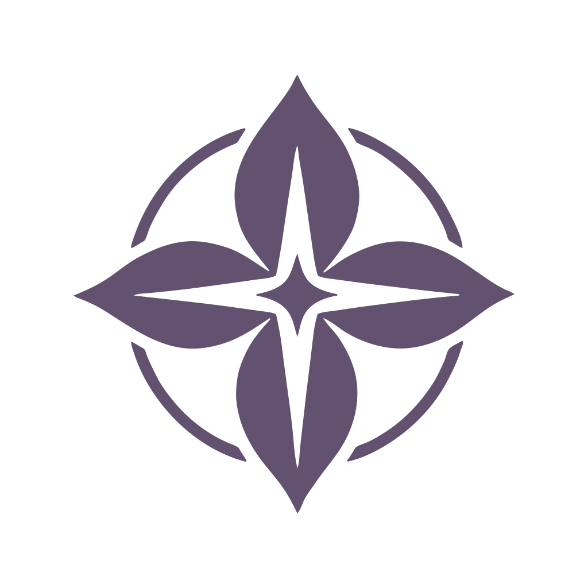

# LIMAGINATION — Visual Identity

> 2026-11-27 · Quiet Compass adopted by owner for brand use; trademark clearance incomplete.
> Governing document: [Brand Constitution v4.0](LIMAGINATION_BRAND_CONSTITUTION.txt)
> Implementation: [Branding Report v4.1](LIMAGINATION_BRANDING_REPORT.txt)

## 1. Identity

- Official brand name and wordmark: LIMAGINATION (LIM + IMAGINATION).
- Official symbol: Quiet Compass — clematis and compass, with four petals, central directional negative space and four segmented circular arcs.
- Motto: Dare to Imagine.
- Philosophical inspiration: Sapere Aude.
- Brand essence: We Begin with Imagination.
- Manifesto: We Imagine Before We Create.
- Operating maxim: Think Freely. Create Responsibly.
- Attribution: Made with LIMAGINATION, only where accurate.

The symbol expresses spiritual beauty and autonomous reasoning as a modern brand interpretation. Preserve the owner-selected traced outline, proportions, gaps and composition; do not redraw, add orbit, sparkle, gradients, shadows, or stretch. Original source color #6D4D74 is retained for reference only.

## 2. Muted Amethyst (unchanged)

| Token | HEX |
|---|---|
| Amethyst Noir | #222025 |
| Deep Amethyst | #62516F |
| Muted Violet | #9D84B7 |
| Soft Amethyst | #C9B5DB |
| Porcelain | #F4F1F5 |

Light pairing: Deep Amethyst on Porcelain. Dark pairing: Soft Amethyst on Amethyst Noir. Black and white versions are for monochrome reproduction. Product palettes remain independent.

## 3. Canonical assets

| Role | Source |
|---|---|
| Original geometry / reference color | [Quiet Compass SVG](visual/quiet-compass-reference.svg) |
| Light background | [Symbol SVG](visual/quiet-compass-light.svg) |
| Dark background | [Symbol SVG](visual/quiet-compass-dark.svg) |
| Monochrome | [Black SVG](visual/quiet-compass-black.svg) / [White SVG](visual/quiet-compass-white.svg) |
| Full wordmark master | [Outlined SVG](visual/limagination-wordmark.svg) |
| Wordmark variants | [Light](visual/limagination-wordmark-light.svg) / [Dark](visual/limagination-wordmark-dark.svg) |
| Combined lockup | [Light](visual/limagination-lockup-light.svg) / [Dark](visual/limagination-lockup-dark.svg) |
| Threads avatar | [PNG 1024](visual/threads-avatar.png) / [SVG](visual/threads-avatar.svg) |
| Compatibility PNGs | [Light](logo.png) / [Dark](logo-v2.png) |

The original wordmark consists of traced letter outlines, not a complete installable font. Limagination Sans development is separate; no font binaries or product font stacks are replaced by this migration.

## 4. Usage

Use full wordmark for company headers and lockups, symbol alone for profile photos, compact brand badges and favicon where legible. Maintain master aspect ratio and padding; check circular crop and 16/24/32/64px reproduction. At 16px the fine gaps may lose clarity; avoid claiming a validated small-size redesign. Do not impose the parent mark, palette or typeface on independent product logos or UI. Do not imply legal registration, endorsement, or sponsorship.

The Threads avatar is opaque Amethyst Noir with Soft Amethyst symbol, 1024×1024. Upload this exact PNG to the LIMAGINATION account only. See [Threads guide](LIMAGINATION_THREADS_PROFILE.md).

## 5. History and legal review

- 2026-11-23: L/ and LIMA. originally adopted.
- 2026-11-25/26: Muted Amethyst adopted and synchronized.
- 2026-11-27: motto/philosophical foundation adopted; owner subsequently selected Quiet Compass and full outlined wordmark.
- Prior logo files are archived in [legacy](legacy/2026-11-27-pre-quiet-compass/); legacy spelling remains valid only as historical context or independent product names, e.g. LIMA TOOLKIT.
- [Trademark review](research/QUIET_COMPASS_TRADEMARK_REVIEW.md): partial search; owner authorized asset migration after disclosure, not a legal clearance or a filing.
