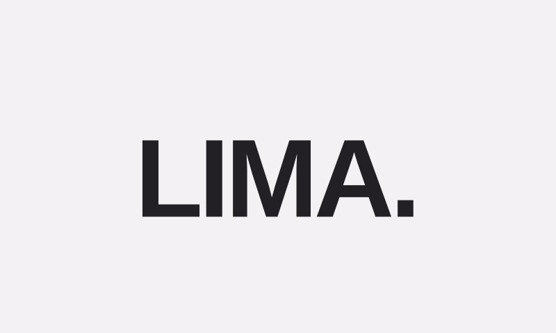

# LIMAGINATION — Visual Identity

> Status: **Approved for company brand use** · Identity approved 2026-11-23 · Muted Amethyst approved 2026-11-25 · synchronized 2026-11-26  
> Governing document: [Brand Constitution v3.0](LIMAGINATION_BRAND_CONSTITUTION.txt)  
> Implementation guide: [Branding Report](LIMAGINATION_BRANDING_REPORT.txt)

## 1. Naming and identity

- **Official brand name:** `LIMAGINATION` (LIM + IMAGINATION)
- **Approved abbreviated wordmark:** `LIMA.`
- **Approved compact brand symbol:** `L/`
- **Brand essence:** We Begin with Imagination.
- **Manifesto:** We Imagine Before We Create.
- **Attribution signature:** Made with LIMAGINATION — only where actual creative/development participation is accurately represented.

The new wordmark and symbol are visual shorthand, **not a renaming** of the brand. Do not use `LIMAGINANTION` as the official spelling.

## 2. Approved visual assets — Muted Amethyst

LIMAGINATION 2.0 replaces the former company mint/teal palette. The company constitution v3.0, wordmark and symbol geometry remain unchanged.

| Token | HEX | Use |
| --- | --- | --- |
| Amethyst Noir | `#222025` | dark base and wordmark text |
| Deep Amethyst | `#62516F` | secondary accent |
| Muted Violet | `#9D84B7` | restrained accent |
| Soft Amethyst | `#C9B5DB` | dark-background symbol and highlights |
| Porcelain | `#F4F1F5` | light base |

Use restrained accents, avoid excessive neon and decorative gradients, and check contrast for each actual text/background pair. Product palettes remain independent. The following logo color pairings implement the approved palette; existing geometry is preserved.

| Role | Preview / source | Background | Foreground |
| --- | --- | --- | --- |
| Abbreviated wordmark — `LIMA.` | [SVG](visual/LIMAGINATION_WORDMARK_LIMA.svg) | `#F4F1F5` | `#222025` |
| Symbol — `L/` | [SVG](visual/LIMAGINATION_SYMBOL_L_SLASH.svg) | `#222025` | `#C9B5DB` |

These SVGs are **approved color/composition source assets** for current web and social use. They contain text glyphs rendered with a common sans-serif stack; their letter shapes may differ slightly by platform. Before physical printing, trademark filings, or exact cross-platform pixel reproduction, create and review an outlined-vector master without changing the approved composition.

## 3. Usage

- **GitHub, website and brand documents:** Display `LIMAGINATION` as the full official company name where clarity is needed. Use `LIMA.` as a prominent short wordmark.
- **Threads/social profile, favicon, compact avatar:** Prefer `L/` symbol for small circular/square crops. Maintain sufficient padding so neither character is clipped.
- **Branded visuals:** Keep the approved background/foreground pairs above for their respective variants. Check legibility at small sizes.
- **Product brands:** FONS, Harbor, RESONA and other product identities may keep separate design systems. Do not automatically impose company colors or symbols on each product.
- **Voice/behavior:** Keep the company constitution's accuracy, accessibility, user-centered responsibility, and honest claims. Avoid making the brand appear to be a registered legal company if that has not been established.

### 3.1 Official Threads profile avatar — symbol confirmed 2026-11-23; colors revised 2026-11-25

The officially selected Threads profile avatar is **L/** in its approved Amethyst Noir / Soft Amethyst composition: [original SVG](visual/LIMAGINATION_SYMBOL_L_SLASH.svg). For profile upload, render a square 1024×1024 PNG without changing the SVG's arrangement or colors. Keep the glyph fully visible after the platform's circular crop. The **LIMA.** wordmark remains a separate brand asset for headers and promotional graphics.

Approved bio, first pinned post, and editing rules: [LIMAGINATION_THREADS_PROFILE.md](LIMAGINATION_THREADS_PROFILE.md). GitHub documentation does not itself update the live Threads account.

## 4. Do not

- Change `LIMA.` to `LIMA` or `L/` to a different character arrangement in the approved variants.
- Recolor the assets, distort their aspect ratio, stretch the characters, or add gradients/shadows without a new explicit brand decision.
- Treat an abbreviated logo as a replacement for the legally relevant full name.
- Use branding to imply ownership, sponsorship or a partnership that does not exist.

## 5. Change record

- **2026-11-23:** Confirmed `L/` as the official Threads profile avatar and published the approved social bio/pinned post in the Threads guide.
- **2026-11-23:** Approved the `LIMA.` wordmark and `L/` symbol from Threads brand exploration. Added SVG source assets, color palette, usage rules, and distinction from the existing official name. The Brand Constitution v3.0 and Limagination Sans technical specifications remain unchanged.

- **2026-11-26:** Synchronized the November 25 Muted Amethyst decision, source SVG colors and documentation. Previous mint/teal assets are historical; legacy PNGs and font specimen are not current logo masters. Live social profile changes are separate.
